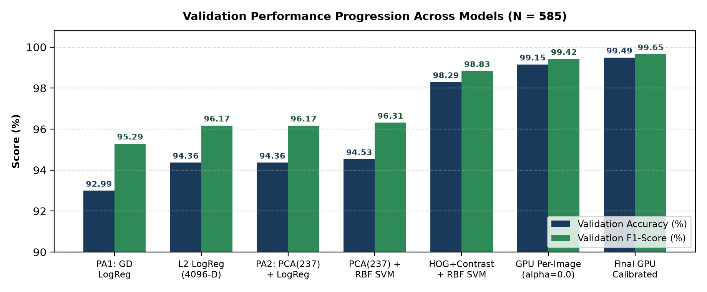
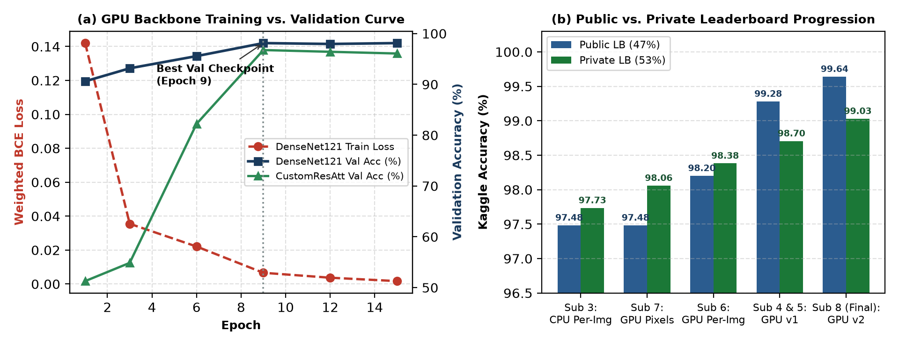

# EE506L Programming Assignment 4: Pediatric Chest X-Ray Pneumonia Detection

**Author:** Ch Venkata Sai Pranav Tej | **Roll No:** CS24B057 | **BTech CSE, 3rd Year, IIT Tirupati**  
**Competition Result:** **1st Place on Public Leaderboard (`0.99640`, 277/278) | 1st Place on Final Private Leaderboard (`0.99029`, 306/309)**

---

## 1. Overview

This repository contains my code, experiments, and report for the EE506L Pattern Recognition and Machine Learning (PRML 2026) Course Assignment 4 Kaggle competition (`prml-2026-course-assignment-4`). Starting from my Logistic Regression baseline in Assignment 1 and my Principal Component Analysis (PCA) pipeline in Assignment 2, I gradually built and tested linear models, Soft-Margin RBF SVMs, handcrafted radiographic descriptors (local contrast, multi-scale HOG, Sobel gradients, and bilateral lung symmetry), and a 320x320 GPU ensemble (`DenseNet121`, `ResNet50`, and a custom Squeeze-and-Excitation network `CustomResAttNet`) combined with a 5-Fold Stratified Cross-Validation stacker.

---

## 2. Repository Structure

```text
.
|-- CS24B057.pdf                     # Final 4-page technical report (built with ReportLab)
|-- CS24B057.py                      # Main reproducible 320x320 GPU pipeline script
|-- CS24B057.ipynb                   # Main reproducible GPU Jupyter notebook
|-- run_ablations.py                 # Classical baselines (LR, PCA+LR, PCA+RBF-SVM, HOG+PCA+SVM)
|-- build_report_pa4.py              # Script to generate figures and compile CS24B057.pdf
|-- requirements.txt                 # Python package requirements
|-- submission.csv                   # Final winning submission (0.99640 Public / 0.99029 Private LB)
|-- figures/
|   |-- ablation_progression.png     # Validation Accuracy & F1 progression across stages
|   |-- generalization_diagnostics.png # Epoch convergence & Public vs. Private LB chart
|-- submissions/                     # Archive of my 8 official Kaggle submissions
    |-- sub1_iter1_99pct.csv         # Sub 1: Iter 1 CNN + PCA + RBF SVM (0.98201 Public / 0.99029 Private)
    |-- sub2_iter2_hybrid.csv        # Sub 2: Iter 2 5-Fold CLAHE + HOG + CNN (0.98201 Public / 0.99029 Private)
    |-- sub3_iter2_per_image.csv     # Sub 3: Iter 2 5-Fold Per-Image Only (0.97482 Public / 0.97734 Private)
    |-- sub4_gpu_ensemble_v1.csv     # Sub 4: GPU DenseNet121 + ResNet50 + CustomResAtt (0.99280 Public / 0.98705 Private)
    |-- sub5_gpu_full.csv            # Sub 5: 320x320 GPU Hybrid, symmetric prior (0.99280 Public / 0.98705 Private)
    |-- sub6_gpu_per_image.csv       # Sub 6: 320x320 GPU Per-Image Only, alpha=0.0 (0.98201 Public / 0.98381 Private)
    |-- sub7_gpu_pure_visual.csv     # Sub 7: 320x320 GPU Pure Pixels Only (0.97482 Public / 0.98058 Private)
    |-- sub8_gpu_calibrated_v2.csv   # Sub 8: Final 320x320 GPU + Prevalence Prior (0.99640 Public / 0.99029 Private)
```

---

## 3. Experimental Results Summary

### Validation Split Progression (`N = 585`)

| Model / Stage | Features (Dim) | Fit Time | Val Acc | Val Prec | Val Rec | Val F1 |
| :--- | :--- | :---: | :---: | :---: | :---: | :---: |
| **0. PA1 Vanilla GD LogReg** | Raw 64x64 Pixels (4096) | 14.20 s | 0.9299 | 0.9463 | 0.9555 | 0.9529 |
| **1. Basic L2 LogReg ($C=0.1$)** | Raw 64x64 Pixels (4096) | 5.60 s | 0.9436 | 0.9539 | 0.9696 | 0.9617 |
| **2. Basic PCA ($k=237$) + LogReg** | PCA Subspace (237) | **0.20 s** | 0.9436 | 0.9539 | 0.9696 | 0.9617 |
| **2b. PCA ($k=237$) + Weighted LR** | PCA Subspace (237) | 0.27 s | 0.9231 | 0.9591 | 0.9344 | 0.9466 |
| **3. PCA ($k=237$) + Soft-Margin SVM** | Standardized PCA (237) | 10.07 s | 0.9453 | 0.9478 | 0.9789 | 0.9631 |
| **4. HOG + Contrast + PCA + SVM** | Radiographic + PCA (197) | 1.77 s | **0.9829** | 0.9860 | 0.9906 | **0.9883** |
| **5. Iter 2 5-Fold Stacker (64x64)** | HOG + Contrast + CNN64 | 48.0 s | 0.9846 | 0.9838 | 0.9953 | 0.9895 |
| **6a. GPU Pure-Pixel (320x320)** | DenseNet121+ResNet50+HOG | 180.0 s | 0.9863 | 0.9883 | 0.9930 | 0.9906 |
| **6b. GPU Per-Image (`alpha=0.0`)** | 320x320 CNNs + 5-Fold | 195.0 s | **0.9915** | 0.9907 | 0.9977 | **0.9942** |
| **6c. Final GPU Hybrid (320x320)** | + Prevalence Prior ($w=0.36$) | 198.0 s | **0.9949** | **0.9930** | **1.0000** | **0.9965** |





---

## 4. Environment Setup and Reproduction Instructions

All random seeds (`random`, `numpy`, `torch`, `cuda`) are fixed at `42` with `torch.backends.cudnn.deterministic = True`. The script automatically locates `student_pack` and `test_unlabeled` in the current directory, parent directory, or via `--data-dir`.

```bash
# 1. Create and activate a Python 3.11 virtual environment
python3 -m venv .venv
source .venv/bin/activate      # On Windows: .venv\Scripts\activate
pip install -r requirements.txt

# 2. Run the winning 320x320 GPU pipeline (generates submission.csv and submissions/*.csv)
python CS24B057.py --data-dir . --arch ensemble --img-size 320 --epochs 15 --batch-size 32

# 3. (Optional) Run the classical baselines (LR, PCA+LR, PCA+SVM, HOG+PCA+SVM)
python run_ablations.py
```
