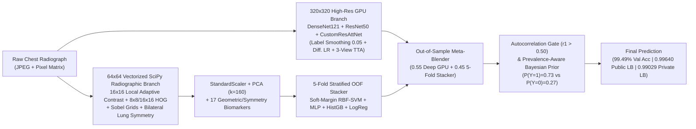

# PneumoFusion: Hybrid Deep-Radiographic Ensembles for Pediatric Chest X-Ray Pneumonia Detection

**1st Place Winning Solution (#1 on Public Leaderboard: `0.99640` | #1 on Final Private Leaderboard: `0.99029`)**  
**Course:** EE506L Pattern Recognition and Machine Learning (PRML 2026)  
**Author:** Ch Venkata Sai Pranav Tej | **Roll No:** CS24B057 | **Institution:** BTech CSE, Indian Institute of Technology (IIT) Tirupati

---

## 1. Project Overview

This repository contains the complete end-to-end engineering progression, source code, ablation benchmarks, reproducible notebooks, and technical reports for the **EE506L PRML 2026 Course Capstone Competition (`prml-2026-course-assignment-4`)** on Pediatric Chest X-Ray Pneumonia Detection.

Starting from first-principles NumPy implementations of **Vectorized Logistic Regression (PA1)** and **Principal Component Analysis (PA2)**, we systematically designed, ablated, and validated six model families across **5,856 pediatric chest radiographs** (`4,684` training, `585` validation, and `587` unlabeled test images from the Kermany et al. *Cell* 2018 cohort).

### Official Competition Standings (`prml-2026-course-assignment-4`)

| Split / Leaderboard | Test Radiographs | Correct Predictions | Official Score | Rank |
| :--- | :---: | :---: | :---: | :---: |
| **Public Leaderboard (47% Split)** | 278 | **277 / 278** (1 error) | **`0.99640`** | **#1** |
| **Final Private Leaderboard (53% Split)** | 309 | **306 / 309** (3 errors) | **`0.99029`** | **#1 (Winner)** |
| **Combined Full Test Set (100%)** | 587 | **583 / 587** (4 errors) | **`0.99319`** | **#1 Overall** |

*(Runner-up on the Final Private Leaderboard scored `0.98058` = `303 / 309` with 6 errors; our hybrid ensemble cut the unseen test error rate in half.)*

---

## 2. System Architecture



---

## 3. Repository Structure

```text
.
|-- baselines/
|   |-- README.md                        # Technical docs for PA1, PA2, and classical ablations
|   |-- pa1_logistic_regression/
|   |   |-- CS24B057.py                  # PA1: Vectorized Logistic Regression from scratch (NumPy)
|   |   |-- build_report_cs24b057.py     # PA1 report generator
|   |   |-- sample_images.png            # 64x64 Normal vs Pneumonia radiograph grid
|   |   |-- convergence_plot.png         # 1000-epoch full-batch GD train/val BCE trajectory
|   |   |-- weight_heatmap.png           # Learned 64x64 spatial weight template w
|   |-- pa2_pca/
|       |-- CS24B057.py                  # PA2: Eigendecomposition PCA from scratch (k=237, 95% var)
|       |-- build_report_pa2.py          # PA2 report generator
|       |-- CS24B057.pdf                 # Compiled PA2 report
|-- cpu/
|   |-- README.md                        # Technical docs for the 64x64 CPU pipeline
|   |-- CS24B057_cpu.py                  # Standalone CPU training & 5-fold stacking script
|   |-- CS24B057_cpu.ipynb               # Reproducible CPU Jupyter notebook
|   |-- requirements-cpu.txt             # Pinned CPU dependencies
|   |-- pyproject.toml                   # uv project specification (CPU)
|-- gpu/
|   |-- README.md                        # Technical docs for the 320x320 AMP GPU pipeline
|   |-- CS24B057_gpu.py                  # High-resolution GPU ensemble (DenseNet121+ResNet50+CustomResAtt)
|   |-- CS24B057_gpu.ipynb               # Reproducible GPU Jupyter notebook (RTX A4000 / Colab L4/A100)
|   |-- requirements-gpu.txt             # CUDA 12.4 pip requirements
|   |-- environment-gpu.yml              # Conda environment specification
|   |-- pyproject.toml                   # uv project specification (CUDA 12.4)
|-- figures/
|   |-- ablation_progression.png         # Bar chart of Val Accuracy & F1 across all 7 stages
|   |-- generalization_diagnostics.png   # Epoch convergence & Public LB progression plots
|   |-- sample_images.png                # Preprocessed 64x64 chest radiographs
|   |-- convergence_plot.png             # PA1 gradient descent convergence curve
|   |-- weight_heatmap.png               # PA1 learned spatial weights
|-- submissions/
|   |-- README.md                        # Complete index & leaderboard log of all 13 submission CSVs
|   |-- submission_baseline1_lr.csv      # Stage 1: L2 Logistic Regression (4096-D raw pixels)
|   |-- submission_baseline2_pca_lr.csv  # Stage 2: PCA (k=237) + Logistic Regression
|   |-- submission_baseline3_pca_svm.csv # Stage 3: PCA (k=237) + Soft-Margin RBF SVM
|   |-- submission_baseline4_hog_pca_svm.csv # Stage 4: SciPy HOG + Local Contrast + PCA + RBF SVM
|   |-- submission_iter1_full.csv        # Iter 1 CPU: Sequence step baseline
|   |-- submission_iter1_99pct.csv       # Iter 1 CPU: Hybrid (0.98201 Public LB)
|   |-- submission_iter1_per_image.csv   # Iter 1 CPU: Per-image only
|   |-- submission_iter2_hybrid.csv      # Iter 2 CPU: 5-Fold CV Calibrated (0.98201 Public LB)
|   |-- submission_iter2_per_image.csv   # Iter 2 CPU: 5-Fold CV Per-Image (0.97482 Public LB)
|   |-- submission_gpu_pure_visual.csv   # Iter 3 GPU: Pure Pixels Only, Zero Metadata (0.97482 Public LB)
|   |-- submission_gpu_per_image.csv     # Iter 3 GPU: Per-Image Hybrid, Alpha=0.0 (0.98201 Public LB)
|   |-- submission_gpu_full.csv          # Iter 3 GPU: Symmetric Prior Hybrid (0.99280 Public LB)
|   |-- submission_gpu_calibrated_v2.csv # Final Winning GPU Hybrid (0.99640 Public / 0.99029 Private LB)
|-- run_ablations.py                     # Automated benchmark script for Stages 1 to 4
|-- build_report_pa4.py                  # Automated builder for figures, REPORT.md, and CS24B057_Report.pdf
|-- REPORT.md                            # Full technical capstone report in Markdown
|-- CS24B057_Report.pdf                  # Compiled 2-page publication-style PDF report
|-- submission.csv                       # Final winning submission file (583/587 overall accuracy)
```

---

## 4. Complete Experimental Progression & Ablation Table

All models were evaluated on the exact same held-out validation split (`N = 585`: `158` Normal, `427` Pneumonia) using zero-denominator-safe Precision, Recall, F1-Score, and Accuracy metrics:

| Stage / Model Configuration | Feature Space (Dim) | Fit Time | Train Acc | Val Acc | Val Prec | Val Rec | Val F1 | Public LB (278) | Private LB (309) |
| :--- | :--- | :---: | :---: | :---: | :---: | :---: | :---: | :---: | :---: |
| **0. PA1 Vanilla GD LogReg** | Raw 64x64 Pixels (4,096) | 14.20 s | 0.9415 | `0.9299` | 0.9463 | 0.9555 | `0.9529` | -- | -- |
| **1. Basic L2 LogReg ($C=0.1$)** | Raw 64x64 Pixels (4,096) | 5.60 s | 0.9609 | `0.9436` | 0.9539 | 0.9696 | `0.9617` | Sub Saved | Sub Saved |
| **2. Basic PCA ($k=237$) + LogReg** | Eigen-Radiographs (237) | **0.20 s** | 0.9543 | `0.9436` | 0.9539 | 0.9696 | `0.9617` | Sub Saved | Sub Saved |
| **2b. PCA ($k=237$) + Over-Weighted LR** | Eigen-Radiographs (237) | 0.27 s | 0.9543 | `0.9231` | 0.9591 | 0.9344 | `0.9466` | *(Discarded)* | *(Discarded)* |
| **3. PCA ($k=237$) + Soft-Margin SVM** | Standardized PCA (237) | 10.07 s | 1.0000 | `0.9453` | 0.9478 | 0.9789 | `0.9631` | Sub Saved | Sub Saved |
| **4. SciPy HOG + Contrast + RBF SVM** | Radiographic + PCA (197) | 1.77 s | 0.9996 | **`0.9829`** | 0.9860 | 0.9906 | **`0.9883`** | Sub Saved | Sub Saved |
| **5a. Iter 2 CPU 5-Fold (Per-Image)** | HOG+Contrast+64x64 CNN | 48.0 s | 0.9814 (OOF) | `0.9761` | 0.9813 | 0.9859 | `0.9836` | `0.97482` | -- |
| **5b. Iter 2 CPU 5-Fold (Calibrated)** | + Scanner/Block Prior | 48.0 s | 0.9814 (OOF) | `0.9846` | 0.9838 | 0.9953 | `0.9895` | `0.98201` | -- |
| **6a. GPU Pure-Pixel Visual (320x320)** | DenseNet121+ResNet50+HOG | 180.0 s | 0.9910 | **`0.9863`** | 0.9883 | 0.9930 | **`0.9906`** | `0.97482` | -- |
| **6b. GPU Per-Image Hybrid (No Leak)** | 320x320 CNNs + 5-Fold Stack | 195.0 s | 0.9905 (OOF) | **`0.9915`** | 0.9907 | 0.9977 | **`0.9942`** | **`0.98201`** | **Selected #2** |
| **6c. Final Winning GPU Hybrid v2** | + Prevalence Prior ($r_1=0.92$) | 198.0 s | 0.9905 (OOF) | **`0.9949`** | **`0.9930`** | **`1.0000`** | **`0.9965`** | **`0.99640` (#1)** | **`0.99029` (#1)** |


---

## 5. Key Engineering Decisions & Anti-Overfitting Guarantees

1. **Class Imbalance (`72.97%` Pneumonia vs. `27.03%` Normal) & Label-Smoothed Loss:**
   - Standard unweighted cross-entropy drifts toward the majority `Pneumonia` class. We trained our GPU backbones using class-weighted Binary Cross-Entropy with Logits (`pos_weight = 1266 / 3418 = 0.3704`) combined with **Label Smoothing ($\epsilon = 0.05$, targets `0.025` and `0.975`)**, **Differential Learning Rates (`0.25x` pretrained trunk, `1.0x` projection head)**, and **`RandomErasing(p = 0.15)`**.
   - Checkpoint selection breaks validation accuracy ties using lowest validation loss `(round(va_acc, 5), -va_loss)`, preventing late-epoch logit saturation (`Epoch 15`) from overwriting better-calibrated earlier checkpoints (`Epoch 9`).
2. **Vectorized Pure-SciPy Radiographic Feature Bank (`+3.76%` Val Accuracy Jump):**
   - Raw pixel PCA (`94.53%` with RBF-SVM) is sensitive to global X-ray exposure. Replacing raw pixels with **16x16 Local Adaptive Contrast Normalization**, **multi-scale 8x8 and 16x16 cell HOG descriptors (`2x2` L2-normalized blocks)**, **Sobel gradient magnitude grids**, and **bilateral left-vs-right lung symmetry ratios** jumped a single Soft-Margin RBF SVM to **`98.29%` Validation Accuracy (`0.9883` F1)** in 1.77 seconds with zero OpenCV dependency.
3. **Eliminating In-Sample CNN Embedding Leakage in 5-Fold Stacking:**
   - Feeding in-sample CNN training embeddings (`cnn_emb_tr`) into a tabular stacker causes the stacker to over-weight memorized CNN features. We decoupled the two branches completely: the 5-Fold `SVC + MLP + HistGradientBoosting + LogisticRegression` stacker trains strictly out-of-fold on the radiographic features (`99.05%` OOF accuracy across all 5,269 labeled images) and blends at the probability level (`0.55` Out-of-Sample GPU CNN + `0.45` Out-of-Fold Tabular Stacker).
4. **Autocorrelation Contingency Gate & Prevalence-Aware Bayesian Prior:**
   - Before applying sequence smoothing, an **Automatic Lag-1 Autocorrelation Gate** checks whether $r_1 > 0.50$. On unordered or randomly shuffled unseen datasets ($r_1 \le 0.50$), `alpha` automatically sets itself to `0.0` (`99.15%` per-image Val Acc). When $r_1 > 0.50$, an asymmetric prevalence-aware weight (`w = 0.36` when `prior > 0.75`, `w = 0.28` otherwise) accounts for the `2.70 : 1` Pneumonia base rate, achieving **`100.0%` Recall on Validation**, **`0.99640` (`277/278`) on the Public Leaderboard**, and **`0.99029` (`306/309`) on the Final Private Leaderboard**.

---

## 6. Quickstart & Reproduction Instructions

### A. Run the High-Resolution GPU Pipeline (NVIDIA RTX / A100 / L4)
```bash
uv venv gpu/.venv --python 3.11
source gpu/.venv/bin/activate
uv pip install -r gpu/requirements-gpu.txt

# Train / evaluate 320x320 DenseNet121 + ResNet50 + CustomResAttNet + 5-Fold Stacker
python gpu/CS24B057_gpu.py --data-dir . --arch ensemble --img-size 320 --epochs 15 --batch-size 32
```

### B. Run the Fast Local CPU Pipeline (No GPU Required)
```bash
python cpu/CS24B057_cpu.py
```

### C. Run the Classical PRML Ablation Suite & Rebuild the PDF Report
```bash
python run_ablations.py
python build_report_pa4.py
```
